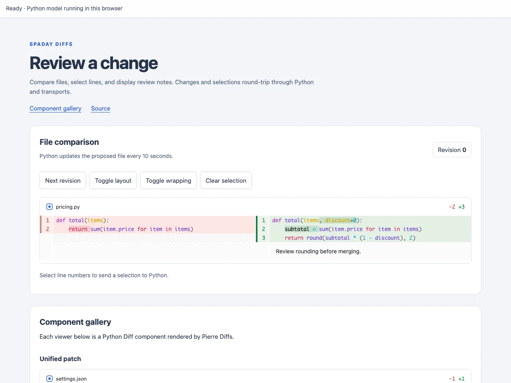

# spaday-diffs

[](https://github.com/1kbgz/spaday-diffs/actions/workflows/build.yaml)
[](https://pypi.org/project/spaday-diffs/)
[](LICENSE)

[Pierre Diffs](https://diffs.com) for [spaday](https://github.com/1kbgz/spaday): syntax-highlighted file comparisons and patches, controlled from Python.

[](https://1kbgz.github.io/spaday-diffs/lite/)

## Install

```bash
pip install "spaday-diffs[examples]"
```

## Usage

```python
import uvicorn
from spaday.backends.starlette import serve
from spaday_diffs import Diff, package

diff = Diff(
    old_file={"name": "hello.py", "contents": 'print("hello")\n'},
    new_file={"name": "hello.py", "contents": 'print("hello, world")\n'},
    diff_style="split",
)
app = serve(diff, packages=[package])
uvicorn.run(app, host="127.0.0.1", port=8000)
```

The same component works in notebooks and standalone apps. The package registers its components and browser assets with spaday automatically.

## Features

- Split and unified layouts with syntax highlighting.
- Two-file comparisons or a selected file from a unified patch.
- Reactive content, layout, line selection, and plain-text annotations.
- Selection and line-click events usable with spaday actions and transports.
- Light, dark, and system themes; package tokens inherit spaday shell colors.
- Bundled assets, including lazily loaded syntax languages and themes.

This is a read-only viewer. Editing, merge resolution, and upstream worker-pool configuration are not exposed.

## Documentation

- [Tutorial](https://1kbgz.github.io/spaday-diffs/docs/src/tutorial.html): build a file comparison.
- [How-to guides](https://1kbgz.github.io/spaday-diffs/docs/src/how-to.html): patches, selection, annotations, and styling.
- [Reference](https://1kbgz.github.io/spaday-diffs/docs/src/reference.html): properties, events, and tokens.
- [Explanation](https://1kbgz.github.io/spaday-diffs/docs/src/explanation.html): rendering and transport boundaries.

## Browser Examples

[Open the browser example](https://1kbgz.github.io/spaday-diffs/lite/) or jump to the [component gallery](https://1kbgz.github.io/spaday-diffs/lite/#gallery).

The browser runs the packaged Python example in Pyodide. Buttons and selections call Python handlers, then transports sends updated model state back to spaday. The gallery renders real Diff components.

## Run the examples locally

```bash
pip install "spaday-diffs[examples]"
python -m spaday_diffs.example
```

Open http://127.0.0.1:8017. The proposed file updates every ten seconds; line-number selections round-trip to Python.

From a checkout, use `make develop`, `make build`, and `make test`. Build the standalone browser preview with `make pyodide-example`, then serve `dist/lite` over HTTP. `make test-pyodide-example` exercises it in Chromium.
